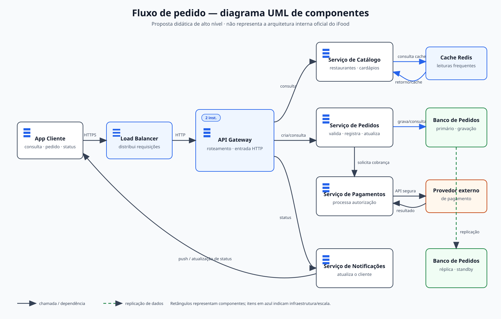

# Atividade 01 — Diagrama de componentes: fluxo de pedido

## 1. Sistema e escopo

**Sistema escolhido:** aplicativo de delivery de comida, usando o iFood apenas como exemplo de domínio.

**Escopo:** fluxo de alto nível para o cliente consultar restaurantes e cardápios, enviar um pedido, efetuar o pagamento e receber atualizações. O modelo é didático e não afirma representar a arquitetura interna real do iFood.

## 2. Componentes e responsabilidades

| Componente | Responsabilidade |
|---|---|
| App Cliente | Exibir restaurantes e cardápios; montar e enviar o pedido; mostrar seu estado e notificações. |
| Load Balancer | Distribuir requisições entre instâncias do API Gateway e evitar concentrar todo o tráfego em uma única instância. |
| API Gateway (2 instâncias) | Receber chamadas HTTP, encaminhá-las ao serviço apropriado e devolver respostas ao cliente. |
| Serviço de Catálogo | Consultar restaurantes, itens do cardápio, preços e disponibilidade; usar cache para leituras frequentes. |
| Cache Redis | Manter temporariamente dados de leitura frequente do catálogo para reduzir consultas repetidas ao banco. |
| Serviço de Pedidos | Validar e registrar pedidos, coordenar a solicitação de pagamento e atualizar o estado do pedido. |
| Serviço de Pagamentos | Solicitar autorização/captura de pagamento ao provedor externo e comunicar o resultado ao Serviço de Pedidos. |
| Provedor de Pagamento | Sistema externo que processa a transação e retorna o resultado da autorização. |
| Banco de Pedidos — primário | Persistir pedidos e seus estados; receber gravações do Serviço de Pedidos. |
| Banco de Pedidos — réplica | Receber replicação do banco primário e apoiar consultas e recuperação/failover planejado. |
| Serviço de Notificações | Enviar ao cliente atualizações de confirmação, pagamento e andamento do pedido. |

## 3. Diagrama UML de componentes

A imagem SVG abaixo é o diagrama exportado para visualização. As setas indicam dependências/chamadas ou fluxos de dados; a replicação está identificada separadamente.

## 4. Narrativa do fluxo

O cliente consulta restaurantes no App Cliente, que envia uma requisição HTTP ao Load Balancer. O balanceador encaminha a chamada a uma das instâncias do API Gateway, que a direciona ao Serviço de Catálogo; este consulta o Cache Redis e, quando necessário, obtém os dados atualizados. Ao confirmar o carrinho, o App Cliente envia o pedido pelo mesmo caminho até o Serviço de Pedidos. O serviço registra o pedido no Banco de Pedidos primário e solicita ao Serviço de Pagamentos que processe a transação no provedor externo. Com o resultado, o Serviço de Pedidos atualiza o estado do pedido e aciona o Serviço de Notificações, que informa o cliente. As gravações do primário são replicadas para a réplica.

## 5. Ponto único de falha e proposta

**Ponto único de falha considerado:** a instância primária do banco de pedidos. Se ela falhar sem recuperação, as gravações e o fluxo de criação/atualização de pedidos podem ser interrompidos. O diagrama propõe uma réplica com replicação e uma estratégia de failover para promovê-la a primária. A réplica reduz o risco, mas a alta disponibilidade depende de configuração operacional, monitoramento e testes de recuperação — não é garantida apenas por desenhar o componente.

## 6. Reflexão

Desenhar a arquitetura antes de codificar funciona como a planta de uma casa: ajuda a visualizar os blocos, seus limites e as dependências antes que decisões difíceis de mudar se espalhem pelo código. Isso reduz retrabalho e permite discutir capacidade, riscos e responsabilidades com antecedência. O diagrama de componentes também cria uma linguagem visual comum: a equipe técnica consegue conversar sobre integrações e responsabilidades, enquanto stakeholders como gestores e investidores podem compreender o fluxo geral sem precisar conhecer detalhes de implementação.

## Arquivos

- `diagrama-componentes.svg` — diagrama visual exportado em SVG.
